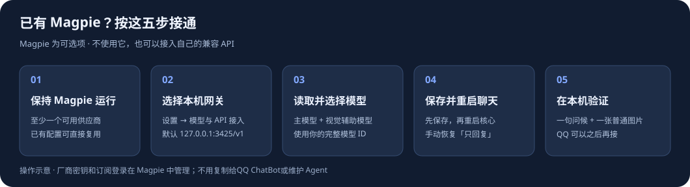

# Magpie 接入教程（可选）

已经装好并能用 Magpie？按下面五步接入QQ ChatBot，无需终端。Magpie 只是模型来源之一；不使用它，直接选择「自定义 OpenAI 兼容 API」，参照 [自有 API 接入说明](MODEL_API.md) 即可。

## 1. 先保持 Magpie 运行

打开本机 Magpie，确认「供应商 / Providers」里至少有一个可用的模型来源。已经配好的账号、API 或本地模型可以直接用，不必重新添加。上游配置与测试都在 Magpie 中完成；本教程不要求你把厂商密钥复制到QQ ChatBot。

如果还没有可用来源，在 Magpie 的「供应商 → 添加供应商」中自行配置，再用该供应商的测试入口确认可用。尚未安装 Magpie 的人，可使用 [官方快速上手](https://usemagpie.ai/docs/zh/start) 自行准备；也可以直接使用自己的 API。

通过 Magpie 聊天时需要让它持续运行，收进托盘即可。QQ ChatBot的开机自启不等于 Magpie 已启动。

## 2. 在QQ ChatBot选择 Magpie

打开「设置 → 模型与 API 接入」，把「接入方式」设为「Magpie 本机网关」。

- API Base URL：`http://127.0.0.1:3425/v1`，标准 Magpie 模式会自动填写。
- API 密钥环境变量名称：保留 `MAGPIE_API_KEY`，这里是变量名，不能粘贴密钥值。
- 主模型与视觉辅助模型：下一步从你的模型清单选择，不要照抄其他人的模型名。

这里使用的是 **OpenAI Chat Completions 兼容端点**，因此地址带 `/v1`，不填完整的 `/chat/completions`。它不是 Magpie 管理页面的地址。

QQ ChatBot直接调用网关；Magpie 的 Agent 列表里没有「QQ ChatBot」也可以接通。无需选择 Codex、Hermes 或改动其他 Agent 的模型配置。此方式依据 [Magpie 官方应用接入说明](https://usemagpie.ai/docs/zh/integrate)。

## 3. 检查连接，选两个模型

点击「检查连接 / 读取模型」。成功时会提示读取到多少个模型，并填充模型输入框的候选列表。检查只读取模型清单，不发送聊天、人设或记忆，也不会自动保存当前表单。

在「主模型」选择支持聊天与工具调用的模型；它负责对话及有限的记忆、日记工具。在「视觉辅助模型」选择支持图片的模型；它负责聊天图片与表情包理解。如果同一模型确实支持两种能力，两个输入框可以选择同一个 ID。

使用清单返回的完整 ID，包含供应商前缀或路由组名称。可以手动输入，但必须是你自己的 Magpie 中真实可用的 ID，不要只填模型的显示名称。模型来自网关目录，而不是本程序写死的列表。[官方模型目录说明](https://usemagpie.ai/docs/zh/integrate#gateway)

## 4. 保存，再重启聊天

点击页面下方「保存设置」，然后点「重启聊天」。看到服务恢复后，在窗口右下角「切换模式」中手动选择「只回复」。重启不会自动解除暂停。

读取清单成功不代表设置已经保存；保存成功也不代表旧核心已切换模型。需要完成这两个按钮，配置才用于后续聊天。

## 5. 在本机对话验证

回到「对话」，发一句简单问候，确认有回复。再发一张没有敏感内容的图片，确认视觉模型能描述画面；需要记忆时，再让她记住一条普通偏好并在「长期记忆」核对。

实际聊天、工具和图片测试会调用你选择的模型，使用对应的额度。先在本机对话验收，接 QQ 是后面的独立步骤；不用为了测试模型先扫码 QQ。

## 需要填网关密钥吗？

Magpie 官方说明，本机回环接入与局域网共享的鉴权规则不同。普通本机网关先按当前配置检查连接，不需要为了本教程新建、编造或导出密钥。[官方鉴权说明](https://usemagpie.ai/docs/zh/integrate#gateway)

如果你的网关配置确实要求鉴权，由你把对应网关凭据设置到 Windows 用户环境变量 `MAGPIE_API_KEY`。厂商 API key、订阅登录和网关凭据是不同的东西，不要把上游凭据误填到这里。配置方法见 [API 接入说明的 Windows 环境变量部分](MODEL_API.md)。

更改环境变量后，从托盘「退出并停止全部」，再从桌面或开始菜单重新打开。仅点 X 会收进托盘，仅重启聊天也可能继承旧环境。程序只显示是否读到变量，不显示它的值。

## Magpie 改过端口怎么办？

本程序的「Magpie 本机网关」预设固定使用 3425。若你的 Magpie 使用其他本机端口，不用改 Magpie：在QQ ChatBot选择「自定义 OpenAI 兼容 API」，把 Base URL 写为实际本机地址并以 `/v1` 结尾，密钥变量名仍可用 `MAGPIE_API_KEY`，然后按同样步骤检查、选模型、保存、重启。

这仍然是在使用你的 Magpie，只是通过自定义地址接入。此教程按同一台 Windows 电脑编写；远程共享请另行配置符合本程序 HTTPS 要求的入口。

## 常见问题

- 连不上：确认 Magpie 在运行、默认端口是否改过，检查地址不是管理页面。不要仅凭托盘里有图标就认为网关一定可用。
- 401 / 403：检查网关鉴权方式、所选环境变量是否已生效及权限；不要把凭据发给维护者。
- 清单为零：在 Magpie 检查是否配置了可用供应商及对外开放的模型，再重新读取。清单来自每个人自己的安装。
- 404 / 非 JSON：核对地址是否包含一次 `/v1`，是否误填完整推理路径或网页地址。自定义端口请按上一节设置。
- 清单能读但聊天失败：检查主模型是否可用、上游额度和权限，以及是否支持工具调用；清单连通只验证了目录入口。
- 文本能聊但看图失败：检查辅助模型是否支持图片、是否填了正确 ID；文本能力不能代替视觉验收。
- 保存后还是旧模型：点「重启聊天」，再手动恢复「只回复」；只关窗口再打开可能仍复用原来的后台核心。
- QQ 未连接：先用本机对话确认模型接通，再看 [QQ 接入说明](QQ_SETUP.md)。QQ 连接与 Magpie 连接分别配置。
- 不想用 Magpie：改选「自定义 OpenAI 兼容 API」，填自己的 API 后保存并重启。QQ ChatBot不会因 Magpie 关闭自动切到另一个服务。

教程核对日期：2026-10-20。Magpie 页面文字可能随版本变化；相关入口以官方快速上手和应用接入文档为准。教程插图为本项目绘制的操作示意，不是 Magpie 客户端截图。
