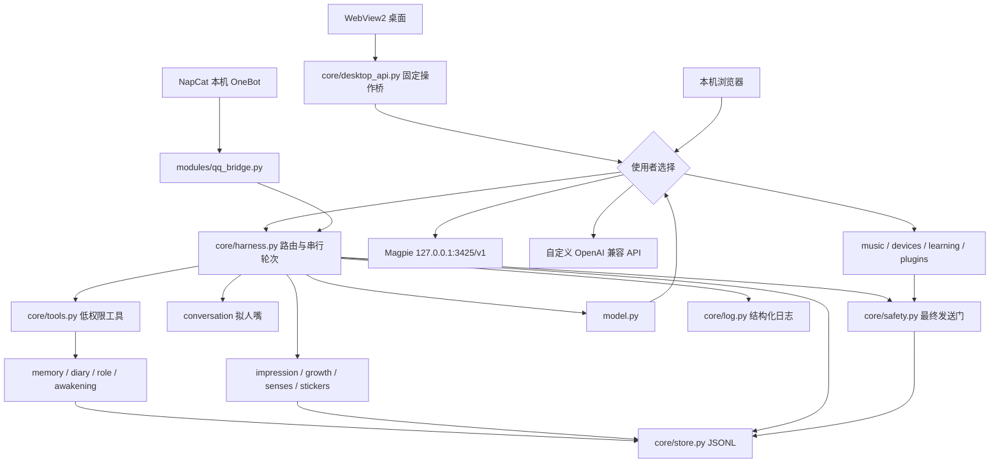

# QQ ChatBot 架构

## 模块与依赖方向

12 模块位置与配置逐项见 HANDOFF 的模块地图。扩展感官 `senses.py`、表情 `core/stickers.py` 不额外改变十二模块边界。

桌面入口 `src/desktop.py` 在独立Python 3.11环境运行WebView2，前端位于 `src/channel/ui/desktop/`。桥接只允许固定本机API、固定数据流和预设文件入口，不提供任意URL请求、shell或文件读写。服务生命周期由 `desktop_backend.py` 管理；关闭窗口不停止服务。暂停请求不等待生命周期锁。消息、模型输出和日志按文本DOM渲染，外部内容不会作为HTML执行。聊天草稿与窗口偏好单独保存在 `.runtime/desktop-ui.json`，不混入JSONL事实源。

程序壳分为三层：`desktop_platform.py` 只管理当前Windows用户的自启/快捷方式/程序登记；`desktop_lifecycle.py` 管窗口、托盘与恢复线程；`desktop_maintenance.py` 管备份/校验/恢复/脱敏诊断，备份恢复复用manage.py。程序偏好走固定桥，未交给对话模型。`service_intent.py` 的跨进程运行意图让维护脚本停机与恢复守护一致，恢复线程有次数窗口且不得解除Safety暂停。窗口X默认收进托盘，退出界面与停止全部是不同的显式动作。版本唯一来源为src/version.py。

表情理解窗口由独立 `desktop/stickers.js` 实现：本机上传 → `core/sticker_intents.py` 解码/限额/动图抽样 → `senses.understand_sticker` → 所选API的辅助视觉模型。模型观察写 `sticker_analyses.jsonl`；主人确认独立写 `sticker_meanings.jsonl`。本机聊天引用media_id，QQ图片按原文件SHA256复用；两条通道都经 `Harness.media_context` 注入画面观察和主人含义数据，随后由主模型结合当轮文字回应。不会仅凭表情推断真实心理结论，也不会执行图中文字指令。

聊天自动识图另经 `core/chat_media.py`：桌面新图片先写chat_uploads、随消息入队，worker识别；QQ图片/商城表情先取OneBot本机文件，必要时受限下载精确允许的QQ图片CDN。下载固定已验证的公共DNS结果，不跟随跳转，不接受任意URL。chat_media_results把观察关联到原消息，当前聊天显示缩略图，后续上下文回填近期观察。内置face仅有名称时明确标注元数据来源。

`Harness` 是组合根：只在此实例化模块并注入 store、safety、session。模块不自行寻找其他模块、读取密钥文件或创建隐式全局单例。通道收到事件后交给 `receive()`；全局队列串行处理主人对话；工具执行和发送均核对 safety generation。调度器复用同一 turn_lock，避免静默学习与聊天争用模型上下文。

## 一条消息如何经过系统

1. QQ 过滤请求事件、群聊和非主人；本机 API 检查 Host、Origin、自定义写请求头。默认不提供跨域权限，不监听局域网。
2. `receive` 在任何模型等待前识别停止词并更新保命状态。消息 ID 去重后，落盘 inbox 和 user chat。暂停时记录收到但不回复，不自动积压补发。
3. Worker 检查本轮 generation；检索按人记忆，拼装角色卡、当前时间、情绪、印象、成长权重与有限窗口历史。后续排队的消息不提前放入当前轮。
4. 模型统一通过 model.py 向所选 API 发送 Chat Completions 请求。使用标准 tool_calls；可执行工具仅限记忆、日记、情绪、约定与表情。工具调用轮次受限，最终完成后拆分气泡。
5. 每个气泡先异步停顿，再核对暂停/主动权限；QQ 在发送前预占持久化分钟配额，采用结构化 text segment，文字中的 CQ 码不能变成 @全体或其他操作。
6. 成功发送写 assistant chat 与 `she_spoke` 日志；失败原文入日志并给 UI 写 notification。网络超时不自动重发；无法判断是否已到达的发送，由人审计。

## 数据模型

角色定制由 `core/identity.py` 独立处理，Harness 注入 Role 与本机 API；桌面 `identity.js` 编辑昵称/描述和两种素材。私有 `persona/identity.jsonl` 是资料事件源，`persona/appearance` 是内容寻址的 PNG/ICO，均在 data 下。窗口生命周期读取相同资料更新系统集成，无模型调用或向 QQ 修改账号资料的动作。默认资产仍来自公开 assets，安装标识保持稳定。

所有记录有 `id`（UUID）、`ts`（UTC ISO8601）。本地行为时间与日记日期按配置 `Asia/Hong_Kong`。JSONL 用 UTF-8、每行一个对象；追加使用进程内 RLock、flush、fsync；启动使用操作系统文件锁拒绝双开。严重损坏直接报文件与行号，不静默丢数据。

记忆是事件流：`kind=memory` 写入；`kind=removed` 记录 tombstone。检索按标签、内容词项与时间半衰期计算分数；永久记忆不衰减，普通默认三天半衰期，重要十八天。衰减不是物理删除；手动编辑/清理必须停机，备份中也可能保留旧记录。事实标注 `source`，模型反思/交叉核查不可冒充用户亲口确认。

`inbox` 保存已见 ID；`processed` 保存处理结果；`outbound` 是发送前占额记录。崩溃后 seen 会阻止重复发送，并将未完成轮次报告到日志。这是“避免重复”的保守策略，不宣称跨 QQ 与本机文件的分布式 exactly-once。故障后可能需要主人重发一句。补课范围受 QQ 能返回的最近 N 条限制。

## 权限分层

| 层 | 能力 | 谁可触发 |
|---|---|---|
| 0 | 查状态、记忆、日记、模型清单 | 本机界面/只读脚本 |
| 1 | 有限记忆、日记、情绪、约定、表情 | 主人聊天中的模型工具白名单 |
| 2 | 网页资料、视觉、whisper、音乐读取 | 配置启用后，受限模块 |
| 3 | 音乐切歌、ADB、MCP、本地可信插件、人格稳定线 | 用户本机操作 + 独立配置授权；模型无通用调用口 |
| 禁止 | 陌生人、自动加好友、群 @全体、支付/银行、厂商模型直连 | 没有实现这些动作出口 |

暂停取消已登记的模型轮次、调度 tick、音乐/设备/学习/MCP 等运行请求。取消子进程会终止本机子进程；外部系统已执行的动作无法倒带。MCP/Python 插件是显式信任的本机程序，不是沙箱；harness 的规则不能约束恶意插件绕过进程直接访问网络，因此默认禁用，启用前必须代码审查。

## 成本与可扩展性

只发送有限历史与前几条检索，不每条聊天都自动写长期记忆。主/辅助模型可独立选择所选 API 的模型 ID；无视觉需求时不调用辅助模型；主动与联网学习默认关；日志记录 usage 以便审计。没有自动总结整个历史、隐式云数据库或远程遥测。

当前存储适合个人规模，读取 JSONL 使用全文件扫描，不适合无界增长。维护 Agent 后续可增加有界缓存与可重建索引，但 JSONL 必须继续作为可审计事实源。新增工具必须经过 Dispatcher 白名单或明确的本机高权限入口，不能直接把 MCP 工具清单整体交给模型。
